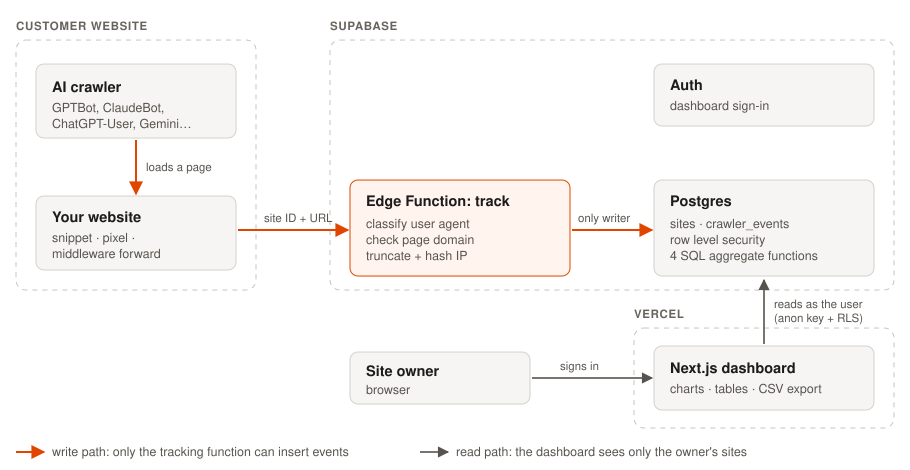

# Crawlwatch

See which AI platforms crawl your website (OpenAI, Anthropic, Google, Perplexity, Meta and more), which pages they read, and how often.

**[Live dashboard](https://ai-crawl-watcher.vercel.app)** · **[Test site with edge forwarding](https://legendary-sawine-97365c.netlify.app)**

**Stack:** Next.js 16 on Vercel · Supabase (Postgres, Auth, Edge Functions) · TypeScript · Tailwind

## Features

- **Overview:** crawler visits with change vs the previous period, active bots, top platform and page, activity chart, training vs retrieval split, live crawl log
- **Platforms, Pages, Activity log:** visits by AI company and purpose, most-crawled pages, every visit with path search
- **Filters:** 24h / 7d / 30d, platform, bot type, applied to every view and export
- **CSV export** of filtered or all data
- **Guided setup:** copy-ready snippets, install check, test visit

## Architecture



Two paths that never share a key. **Writes** go through one Edge Function, the only code holding the key that can insert events. **Reads** come from the dashboard as the signed-in user, and row level security limits every query to that user's own sites. Vercel and Supabase both run in Mumbai.

### How a visit is tracked

1. **A crawler loads a page**, and the visit is reported one of three ways:
   - the `<head>` snippet (about 320 bytes, loaded async);
   - a `<noscript>` pixel, for crawlers that load images but skip JavaScript;
   - a request from the site's own middleware (server or edge), for crawlers that fetch only HTML.
2. **The function classifies the request** from its own user agent against 31 signatures across 18 platforms, typed as training, search or assistant. Other bots are stored as Unknown; human visitors are never stored.
3. **It checks and cleans the data:** the page host must match the site's domain, query strings are dropped, and the IP is truncated (/24 or /48) and then hashed with a secret salt and the site ID.
4. **It stores one row** and always answers with a no-op script, a 1×1 GIF or a 204, so the host page never breaks.
5. **The dashboard reads totals** from four SQL functions that aggregate inside Postgres, so it downloads summaries rather than raw rows.

**Why three capture paths:** I asked real ChatGPT, Claude and Gemini sessions to read the test site. None of their fetchers ran JavaScript; only the test site's edge forwarding caught them. A snippet-only tracker would miss most real AI traffic.

### Key decisions and trade-offs

| Decision | Why | Trade-off |
| --- | --- | --- |
| Supabase for database, auth and ingest; no separate backend | Far less to build, run and secure; login and per-user access come built in | Tied to Supabase; some rules live in migrations |
| Ingest in a Supabase function, not a Vercel route | The dashboard never holds the write key, and tracking keeps working during dashboard deploys | A second runtime (Deno) and deploy step |
| Store bots only | Nothing stored about people, and far less data | No human traffic to compare against |
| Totals computed in SQL | Fast as data grows; every view and the CSV agree | Logic lives in migrations, harder to change than TypeScript |
| Row level security, not app checks | A dashboard bug can't leak another user's data | Rules need their own tests (the smoke test) |
| Fresh data on every click; no prefetch or client cache | Numbers always match the database | ~0.2–0.3 s per click, shown with instant feedback (highlighted filter, progress bar) |
| Polling every 5 s for the live log | Simpler and cheaper than a socket per viewer | Up to a few seconds of delay |
| Vercel pinned to Mumbai, next to the database | Measured ~200 ms per query from the default US region, a few ms after | Users far from India pay one longer hop |
| IP verification of crawlers: built, then removed | Real Claude and Gemini fetches came from unlisted addresses, so genuine visits were labelled fake | User agents can still be faked |

### Security and privacy

- **Keys stay apart:** Vercel has only the public anon key; the service role key stays inside Supabase.
- **Visitor privacy:** IPs are truncated before hashing and salted per site, so they can't be reversed or joined across sites. URLs lose query strings that might carry tokens.
- **Safe install check:** "Check installation" fetches the customer's homepage from our server, following redirects by hand and refusing private, loopback and cloud-metadata addresses (SSRF).
- **CSV injection guard:** cells starting with `= + - @` are escaped, since user agents are attacker-controlled.

## Run locally

Needs Node 24 and Docker.

```bash
npm install && npx supabase start
```

Copy `.env.example` to `.env.local` and fill it from `npx supabase status -o env`, then:

```bash
npm run seed:demo && npm run dev
```

Open http://localhost:3000 and sign in with the demo account `seed:demo` prints. To add traffic to a site, `npm run visits:send -- <site-id> <domain>` sends realistic bot visits through the real endpoint, and `npm run visits:backfill -- <site-id>` writes 30 days of history. Sites filled by `seed:demo` or the backfill show a "Sample data" tag.

## Tests

```bash
npm test && npm run smoke
```

76 unit tests cover classification, URL and IP handling, CSV, time zones and the SSRF guard. The smoke test sends real requests through the tracking function and checks that another user, or an anonymous client, can read nothing. CI runs lint, types, both test suites and a build on every push.

## Deploy

1. **Supabase:** `supabase link`, `supabase db push`, set the `IP_HASH_SALT` secret, then `supabase functions deploy track --no-verify-jwt`.
2. **Vercel:** import the repo and set `NEXT_PUBLIC_SUPABASE_URL` and `NEXT_PUBLIC_SUPABASE_ANON_KEY`. The service role key never goes on Vercel.

## Limits and next steps

- **Most AI fetchers don't run JavaScript**, so sites without server or edge forwarding see only part of their AI traffic.
- **User agents can be faked**, and the site ID is public. Next: a per-site secret for server forwarding and per-site rate limits.
- **Every page view calls the function** (humans are answered, not stored). Supabase's free plan allows 500k calls a month, about 16k page views a day. Next: skip ordinary browsers in the snippet, then upgrade to Pro (2M calls).
- **At larger scale:** daily rollup tables and monthly partitions once dashboard queries pass ~200 ms.
